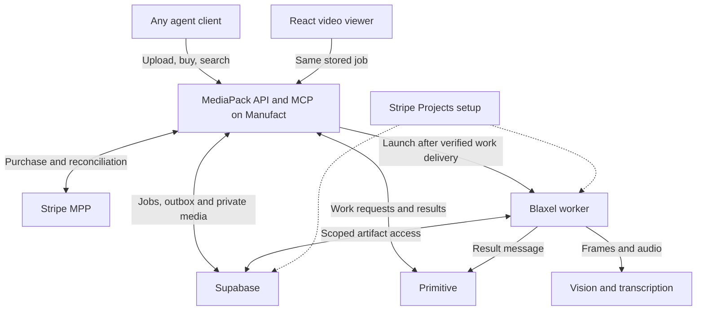

MediaPack coding and setup plan

> Historical implementation plan. [DECISIONS.md](DECISIONS.md) supersedes the combined Vite/mcp-use hosting design below: the current app is Next.js on Blaxel with a separate MCP proxy on Manufact. Follow the [README](README.md) and [release checklist](docs/RELEASE-CHECKLIST.md) for current commands and provider gates.

Product to build
MediaPack is general video search and retrieval for agents. A caller uploads a video, buys one bounded pack, searches spoken content and visible actions, then requests the source frames and clips needed for its task. The agent decides how to use those results. A human viewer shows the same search results, activity, allowances and payment receipt.
Build a complete single-video workflow first. The data model should support many independent videos, but the MVP search call targets one paid video job. Search across a library of videos can follow later using the same video/segment records.
Examples using the same interface:
- “Where does the presenter export the report as a PDF?”
- “Find the part that explains the pricing tiers.”
- “Show where the instructor changes the camera setting.”
- “Find when the value changes after refresh.”
- “Which moments show the red backpack?”
The last two may require visual evidence even when there is no useful narration. The implementation must support visual indexing, not only transcript keyword search.
The design references are concepts, not sample backend responses. A bug-report format is an optional caller-side template, not a special database field, core route, or product identity.
Fixed technical choices
Component    Choice and purpose
Runtime    Node.js 22.22.2 or a newer version supported by all pinned dependencies; TypeScript
Control service    mcp-use v2 MCPServer, its Hono HTTP app, hosted on Manufact
Agent interface    HTTP MCP tools plus explicit REST payment/upload endpoints and a small CLI helper
Human interface    React + Vite under /app, with shared components for MCP Apps where supported
Persistent state    Supabase Postgres with migrations, transactions, ownership checks and RLS
Media storage    One private Supabase Storage bucket; immutable source objects and derived artifacts
Transport    Primitive messages for actual work requests and results
Compute    Named, bounded Blaxel processes with keepAlive: true
Payments    Stripe MPP, shared payment tokens only, sandbox mode for the demonstration
Buyer    Link CLI/Agent Wallet using a configured approval policy or one preapproved test spend
Vision/search    OpenAI Responses API behind a replaceable adapter; default gpt-5.4-mini after account smoke test
Transcription    OpenAI whisper-1, verbose_json, segment timestamps, behind a replaceable adapter
Provisioning    Stripe Projects for the actual required Blaxel/Supabase resources when existing account/credit access supports it
Recovery    Supabase Cron + pg_net calls an authenticated bounded /internal/tick; Postgres owns leases and outbox state

These choices deliberately share the control service. There is no separate Next.js service, vector database, Redis queue, or second agent messaging provider in the first build. The caller can be any supported agent, including a research, support, editing, or coding agent.
OpenAI's documented vision route accepts image inputs. Feed it frames, not raw MP4 files. The default transcription model is chosen for its documented timestamped output; model access and real output shape must pass the setup checks. [S11–S13]
Architecture

Primitive is the work transport. A work-delivery webhook reaches MediaPack, which records the event and dispatches the appropriate Blaxel operation. The worker produces artifacts and sends a result through Primitive. MediaPack verifies that result and applies it to the durable job. The diagrams in diagrams/ show both architecture and the detailed sequence.
Stripe Projects is setup infrastructure. Do not invoke account provisioning or buy a new provider plan for each video search. stripe projects share later supplies a stack link; it does not contain the application code or every configuration value. [S1]
MVP limits and product behavior
The first pack costs USD 0.50 in Stripe sandbox and includes one video, indexing, three searches, eight delivered frames, fifteen total seconds of unique exported clips, and 8,000 characters of evidence prose. Retain access for 24 hours after payment. Quotes expire after ten minutes. Source upload reservations expire after one hour if incomplete or unpaid.
Allow 100 MiB and 180 seconds per source, with maximum long edge 1920 and short edge 1080. Inspect rotation metadata so a supported portrait video works. Audio is optional. Start with MP4 and WebM that ffmpeg can decode. Return a clear error when content falls outside the supported limits.
The price is a hackathon fixture. Measure actual model and worker usage before claiming margin or setting production prices. Stripe documents a USD 0.50 minimum for SPT card payments. [S2]
Product rules:
1. One purchase funds indexing and the included retrieval operations. Polling and identical operation retries do not trigger another purchase.
2. The agent receives compact matches and requests the evidence it needs. It does not automatically receive the entire raw index.
3. Every returned match points to existing frame or transcript identifiers. Resolve timestamps from stored source records.
4. No-match and insufficient-evidence outcomes are valid. A missing visual sample does not establish that an event never happened.
5. Payment receipt, processing completion, and delivered artifacts are distinct facts.
6. The UI displays database-backed states. Do not implement simulated progress timers, manufactured receipts, hardcoded timestamps or canned search answers.
CONTRACTS.md contains the canonical API shapes, access model, tables, transaction requirements, payment state gate, message envelope and allowance accounting. Use that file as the source of truth when details overlap.
Phase 0 — integration smoke checks
Target the first hour. Resolve these risks before polishing the frontend.
A. Scaffold the current framework
Read the current v2 quickstart and installed package engines. The documented scaffold is: [S5]
node --version
npm view mcp-use version engines
npm view create-mcp-use-app version engines
npx create-mcp-use-app@latest mediapack --template mcp-apps --install --no-skills
Use an isolated directory when a repository already exists. Record and pin the actual v2 version returned during setup and commit the lockfile. Do not invent a particular current npm version. Set the selected Node version in the app's runtime configuration.
The v2 code shape uses import { MCPServer } from "mcp-use", inputSchema/outputSchema, a default-exported server, and view components under views/<name>/view.tsx. Older examples using mcp-use/server, schema, resources/, or widget() are a different API generation. [S5–S6]
Add exact-version dependencies consistent with the scaffold: Stripe, mppx, @supabase/supabase-js, @primitivedotdev/sdk, @blaxel/core, OpenAI, Zod and the needed Hono/Vite packages. Inspect the current install and pin it rather than forcing incompatible transitive versions. Primitive SDK 2.4.0 was inspected for the contracts in this package. [S8]
Smoke check: one real /health route, one authenticated MCP tool, one v2 App view, and Vite static assets under /app. Confirm the production build contains all assets and the view can render in the target client. Tools must still return usable structured data if the host cannot render Apps.
B. Prepare the Stripe merchant and buyer
Merchant requirements:
- Stripe sandbox secret key and the associated profile_test_ ID.
- A stable server-only MPP signing secret and configured public origin.
- A webhook endpoint subscribed to the relevant PaymentIntent events, with its own signing secret.
For local development: [S2, S3]
stripe login
stripe listen --forward-to localhost:3000/webhooks/stripe
Keep the local listener's webhook secret distinct from the deployed webhook secret. Test mode must be an explicit checked configuration: fail startup on a live merchant key or a non-test profile while PAYMENTS_MODE=test.
Build the current official MPP example as a small disposable endpoint first. Inspect the installed SDK for challenge binding, request-scoped PaymentIntent metadata, receipt reference mapping, lifecycle hooks, and replay behavior. Record findings in docs/verified-integrations.md in the application repo.
Then wire the job-aware purchase route from CONTRACTS.md. A generic MPP validator proves protocol handling but does not replace testing this job entitlement and actual Link buyer. Run the validator against a disposable authenticated quote/job using its supported header/request options, or a separate sandbox-only smoke endpoint that cannot unlock paid jobs. Never weaken production authorization for the validator.
Buyer setup: log in to Link with the required agentic payment permission, then inspect whether an approval policy is actually configured. A prompt saying “budget $0.50” is not a wallet policy. The baseline demo may use a spend request that was approved before recording. [S4]
npx @stripe/link-cli auth login
After installation, inspect link-cli --help and the current MPP command documentation. The two supported patterns are:
link-cli mpp pay <job-purchase-url> --test --method POST
  --data '<unchanged quote JSON>'
  --header 'X-MediaPack-Token: <client capability>'
  --context '<specific explanation of at least 100 characters>'
link-cli mpp pay <job-purchase-url>
  --spend-request-id <previously approved shared-payment-token spend request>
  --method POST --data '<unchanged quote JSON>'
  --header 'X-MediaPack-Token: <client capability>'
These illustrate command shapes, not credentials to put in shell history or recorded transcripts. Implement the buyer helper to load its client header securely, preserve the same body, and persist the Link spend-request ID. An approved spend request must itself have been created in test mode for the actual merchant and amount. Verify test propagation with the installed CLI; a flag does not make unrelated infrastructure purchases free.
Never put Link wallet credentials or SPTs into MediaPack's worker environment or database. Do not run the buyer automatically with real funds.
C. Prepare Supabase and Stripe Projects
Inspect the user's existing linked accounts first. Stripe Projects documents these discovery/setup commands: [S1]
stripe plugin install projects
stripe projects init
stripe projects catalog blaxel
stripe projects catalog supabase
The next commands create resources or change billing. Select the actual credit-covered plan and authorized account before running them:
stripe projects add supabase/project
stripe projects add blaxel/<approved-plan-from-current-catalog>
stripe projects add blaxel/sandbox
stripe projects env --pull
Blaxel's integration guide uses blaxel/tier-1 as an example top-up plan; it is not a universal free-tier instruction. The guide requires activating an appropriate plan before creating resources. Reuse hackathon credits and an existing workspace when supported; do not create a second paid account just for a stack listing. [S9]
Create the private bucket, set its file-size and allowed-type limits, and apply the SQL migrations. Enable Cron and pg_net for recovery. Store the internal tick credential in Supabase Vault and have Cron POST to /internal/tick every minute. Also attempt an immediate bounded dispatch after the originating database commit for normal demo latency; the scheduled tick recovers abandoned work. [S10]
Projects credentials are written locally; deploy the required server secrets to Manufact separately through its supported environment configuration. Do not commit .env, wallet files, project vault material, signed URLs, or access tokens. Inspect the generated Projects state before committing it to a public repository.
D. Prepare Primitive
Use two actual managed addresses: control and worker. Check sending permissions and register the corresponding webhook routes without replacing unrelated endpoints. Send a real small JSON request from control to worker, reply with an explicit result idempotency key, and verify both signatures and the resulting thread in your database. [S8]
Verified SDK pattern:
import primitive from "@primitivedotdev/sdk";
import { verifyWebhookSignature } from "@primitivedotdev/sdk/api";

const primitiveClient = primitive.client({ apiKey: process.env.PRIMITIVE_API_KEY! });

await primitiveClient.send(
  { from, to, subject, bodyText: JSON.stringify(requestEnvelope) },
  { idempotencyKey: logicalRequestKey }
);

await primitiveClient.reply(
  receivedEmail,
  { text: JSON.stringify(resultEnvelope) },
  { idempotencyKey: logicalResultKey }
);
For the real route, read raw bytes/text before any JSON parsing and call the official signature verifier with the Primitive-Signature header and webhook secret. Accept the supported received-email event only after its parsed body is complete, then persist the stable event ID. Source sender and operation ownership still require application validation.
Persist each logical outgoing body, hash and idempotency key before sending. Use a different explicit key for an acknowledgement versus the final result. Retrying a key with changed content can replay the old outcome. Full contracts are in CONTRACTS.md.
E. Prepare Blaxel and the model adapter
Create a reusable worker image with Node, ffmpeg, ffprobe, the built worker code, CA certificates and only required runtime libraries. Verify the image in a sandbox before using it for paid jobs. Map provider credentials correctly: the native SDK uses BL_API_KEY and BL_WORKSPACE; Projects can return BLAXEL_PLAN_API_KEY and BLAXEL_PLAN_WORKSPACE, which require explicit handling. [S7, S9]
Run a tiny named process and verify exit status and logs. Then launch an asynchronous media operation with waitForCompletion: false, keepAlive: true and a bounded timeout. Without keep-alive, an idle client connection can allow the sandbox to suspend even though the detached process still exists. A nonzero exit code needs explicit handling. [S7]
Test the chosen vision model with one actual frame and transcription with one short audio file. Use OpenAI Responses image input and whisper-1 with verbose JSON and segment timestamps. Both model names remain configurable; fail clearly on account/model unavailability. No API call has been executed by this handoff. [S11–S13]
Repository layout to implement
Keep one application and one worker package. A monorepo is optional; do not turn scaffolding into a project of its own.
Path in the future application    Responsibility
src/server.ts    v2 MCPServer export, Hono middleware, routes and view registration
src/config.ts    Parse environment; validate sandbox mode and required capabilities
src/contracts/    Shared Zod schemas, domain types, canonical hashes and error codes
src/services/clients.ts    Anonymous capability bootstrap, client ownership and viewer pairing
src/services/videos.ts    Signed upload, completion, validated media and quote creation
src/services/payments.ts    Purchase-state gate, Stripe adapter and reconciliation
src/services/operations.ts    Idempotent operations, allowance reservation and leases
src/services/outbox.ts    Bounded dispatch/reconciliation for Primitive and worker launches
src/adapters/primitive.ts    Verified send/reply/webhook APIs; stable logical message identities
src/adapters/blaxel.ts    Named process launch, status, timeout and cleanup
src/adapters/storage.ts    Immutable objects and scoped signed URL issuance
src/adapters/models.ts    Schema-validated vision, ASR and search calls
src/routes/    REST, raw webhooks, internal tick and worker-scoped artifact access
src/tools/    Thin MCP wrappers over the same domain services
worker/    Fixed runner, ffprobe/ffmpeg pipeline, index/search/extraction, result delivery
app/    React/Vite standalone viewer and shared visual components
views/    v2 MCP App views using shared components and useToolContext
supabase/migrations/    Tables, RLS, unique constraints, transaction functions and scheduler setup
scripts/    Small client/bootstrap/uploader, verified integration checks and demo runner
tests/    Contract, payment-recovery, operation-budget and real-media integration tests
docs/verified-integrations.md    Actually installed versions, required account capabilities and smoke results

Serve /app/ using Vite's matching base path and Hono's static middleware. Resolve the built asset root from an explicit path or import.meta.url, not accidental working-directory assumptions. Register /mcp, /v1, /webhooks, and /internal before the SPA fallback so an API error cannot turn into HTML. [S6]
Media algorithm
1. Preflight and immutable source
After upload completion, create a cheap bounded probe operation. Check the actual object and bytes, compute SHA-256, run ffprobe, inspect duration/rotation/dimensions and streams, then write verified metadata. Reject unsupported input before offering a paid quote. Account for this limited unpaid work separately and cap its concurrency and total storage.
Use the original source as the authority. If a normalized derivative is needed, keep both hashes and an explicit source-time mapping. Never replace the source object in place.
2. Build a multimodal index
For up to 180 seconds, sample approximately every two seconds, at most 90 baseline frames, with an overall cap of 96 internal frames if boundary frames are added. Preserve actual presentation timestamps from the decoder. Resize index images to a sensible analysis size; retain source dimensions in metadata.
Pass no more than 12 images per vision request, at most eight index calls, with concurrency two. Each prompt asks for concise observable descriptions and visible text keyed to the supplied frame_id values. It must not invent IDs, source timestamps, intent or a hidden event. Validate the returned schema and IDs. Store bounded descriptions per frame.
If audio exists, extract mono 16 kHz audio and transcribe once. A three-minute mono PCM recording is small enough for a practical upload, but still enforce the provider's actual request-size limit. Use verbose_json with timestamp_granularities: ["segment"] for whisper-1; preserve ASR segment IDs and times. Audio absence, silence, transcription failure and successful transcription are separate states. [S11]
Combine frame observations and ASR segments into temporal records. Store the full internal index as a versioned private artifact and the searchable records in Postgres/JSONB. Large-scale embeddings and a vector database are unnecessary for a three-minute source. The small index can be searched with a bounded model call; the schema leaves room for later cross-video retrieval.
Index model prompts treat video text and speech as data. Embedded instructions such as “ignore the user” are quoted content, not authority to execute commands or change budgets.
3. Search the index
For each allowed question, make at most one search-model call over the bounded stored index. Ask for at most three candidate matches using existing frame/segment IDs, a short evidence-based description, and optional no-match output. Resolve intervals from those IDs on the server and validate all ranges against source duration.
Bound internal index text before model submission; do not silently overflow context or spawn an unbounded hierarchy of agents. Search output is a candidate supported by inspected samples and/or transcribed speech. For a visual action that needs finer timing, the caller can request frames around the candidate or a short source clip within the same pack.
Sampling can miss short events between frames. The first version should disclose this limitation and return “not established from the indexed evidence” when appropriate. A later targeted refinement pass may inspect extra source frames under an explicit internal compute allowance.
4. Extract actual evidence
get_frames returns existing source frames or decodes the requested timestamps. It includes actual frame presentation times and hashes. get_clip decodes/re-encodes the requested range into a browser-playable MP4, maps it to the source interval and verifies the measured result duration.
Use process argument arrays and fixed worker commands. Do not interpolate user filenames or questions into shell strings. Cap CPU time, output size, frame dimensions and model retries. ffmpeg success requires an acceptable exit code and a validated artifact, not merely a completed promise.
Write artifacts to private durable storage before publishing the Primitive result. The control service applies only a result matching the current lease/generation and source identity. Repeated operations return cached results and preserve the same allowance counters.
5. Deliver a pack
The pack is a JSON manifest plus authorized frame/clip references and the Stripe receipt reference. Include source digest, query, match ranges, artifact hashes, actual delivered usage, mode and job ID. A caller can download the manifest, use the images, or open the clip.
The service can provide a concise source-grounded answer. Specialized formats such as a bug reproduction report, tutorial notes or a clip list should be small templates over these results, not separate pipelines in the first release.
UI implementation
Use design/01-general-video-search.png as the main direction: dark charcoal navigation, warm ivory canvas, chartreuse primary actions, violet payment accents, and large readable video evidence. Use real React components and accessible HTML controls. Do not turn a generated screenshot into a background with fake clickable hotspots.
Screen    Functional content
Videos and upload    Drag/drop or file picker, actual upload state, verified duration, supported limits, clear preflight rejection
Quote and purchase    Fixed price/allowance, current payment mode, quote expiry and wallet handoff when needed
Search    One video selector, natural-language question, matching intervals, visual/speech labels and source evidence
Source inspection    Video player, actual timestamps, frame requests, clip selection and remaining allowance
Activity    Factual client request, payment, Primitive dispatch/result, worker and operation events
Pack and receipt    Actual manifest/artifacts, source hashes when expanded, budget usage and verified test receipt

Build the standalone search and activity views first, then reuse the result component in the MCP App. The framework gate should already have proved that a small v2 view renders. Every primary action must hit its real API operation. Keep loading, empty, no-match, expired quote, exhausted allowance, reconciling payment and failed-worker states readable.
The general-search image contains illustrative transcript quotes and timestamps. Its expanded explanatory allowance box should become a compact label or tooltip in the real product. The video preview in that concept must be implemented either as the owner's original-video viewer or an actually materialized clip; do not claim a clip exists before extraction succeeds.
The other design images use a bug recording as layout reference. Replace their headings and content with generic query, match and source fields. The activity list's elapsed job times must come from runtime events and remain distinct from video timestamps.
For the operator to watch an agent-owned job, pair the viewer to the same client_id once before the demo. Use an authenticated CLI-issued, short-lived one-time pairing code and an HttpOnly browser session. Independently bootstrapping a second client in the browser would create a different owner. Do not expose the reusable client capability in a public URL.
Ordered build milestones
The hour estimates below are a planning guide for one lead with parallel coding help. Do not spend the final hours adding sponsors before the complete flow works.
Milestone    Approximate effort    Completion gate
0. Provider and framework smoke checks    45–60 minutes    Actual REST/MCP/view, Primitive request/reply, Blaxel process, model calls and sandbox payment path verified
1. Shared contracts, database and upload    60–90 minutes    Client-owned immutable video is validated and a real quote/job exists
2. Paid job and durable dispatch    90–120 minutes    One Stripe purchase creates one entitlement and one Primitive operation
3. Real index and search    90–150 minutes    Arbitrary query returns source-linked matches from a new input
4. Frames, clips and pack allowance    60–90 minutes    Playable clip, real frames and duplicate-safe counters
5. React and MCP result views    60–90 minutes    Search, source, activity and receipt use the actual APIs
6. Recovery and cold-caller demo    60–90 minutes    Duplicate/crash tests pass and a fresh caller completes the documented workflow
7. Submission packaging    30–45 minutes    Clean repo, setup guide, recorded demo and actual stack share URL if available

Once schemas are committed, Claude may parallelize three workstreams: control/payments/database; media worker/search; UI/MCP views. One lead owns shared contracts and integrations. Merge behind the same service layer and preserve the actual integration smoke tests.
If time tightens, deliver one short uploaded video, one supported query, one retrieved clip and the real paid Primitive round trip before broadening the supported examples. Keep the API's query and video fields general. Optional follow-ups are cross-video search, Armature session evaluation, Primitive encrypted payload offload, more clip formats and specialized result templates.
Acceptance and demonstration
Complete these checks on the implemented app:
1. Real media: submit a new short recording; verify its digest, metadata, extracted frame contents, actual clip playback and source times.
2. General search: test spoken-content retrieval and a silent recording with a visually observable event. Ask the same question of an unrelated input and require a different grounded result or no match.
3. Real commerce: complete one actual Stripe sandbox purchase with the buyer helper and link the verified PaymentIntent to the job. Show the receipt from that result.
4. Real transport: prove Primitive request and result message IDs exist for the same operation, and the corresponding Blaxel process generated the recorded artifacts.
5. Payment concurrency: simultaneous purchase requests produce one successful purchase/entitlement; a paid retry does not invoke payment again.
6. Payment crash: kill the app after Stripe succeeds but before the entitlement transaction. Signed webhook recovery marks the same job paid and writes one outbox event.
7. Uncertain outcome: a simulated payment timeout returns reconciling. The app does not issue a new challenge or token purchase until positively resolved.
8. Worker and message retries: duplicate Primitive events and a recovered dispatch do not duplicate indexing or allowance. A late result from an older lease cannot win.
9. Allowance: concurrent requests cannot exceed frame/clip/search limits; identical retries return the same operation/result and do not spend the allowance twice.
10. Ownership: one client's token cannot read, buy, search or mint artifact access for another client's video, even with a valid unrelated payment receipt.
11. Cold caller: a supported agent runs the documented bootstrap/client setup, uses a real video and arbitrary question, completes the authorized purchase, and retrieves useful source evidence without hardcoded tool outputs.
12. Truthful UI: no payment success without verified Stripe state, no indexing completion before a valid result, no source clip before the file exists, and no unmeasured savings claims.
For a concise demo, use a real product walkthrough and ask an agent: “Find where the presenter exports the report as a PDF and return a short source clip.” Give the actual MediaPack URL and configured authorized sandbox spend. Show the quote, test purchase, Primitive delivery, generated search result and playable clip. Do not give the caller the event timestamps.
A preapproved specific spend is a valid setup choice; describe it accurately. Unattended future purchases require an effective configured wallet policy and an actual successful test. A fresh agent that was explicitly given the URL demonstrates self-onboarding, not spontaneous discovery against competitors.
Handoff completion checklist for Claude
Deliver the app repo with pinned dependencies, lockfile, migrations, .env.example, worker image/build instructions, CLI/bootstrap/uploader, REST/MCP usage examples, and provider setup instructions. Include integration verification results and a demo run manifest with job, payment, Primitive operation/message and artifact references, redacting capabilities and credentials.
Keep mock/test fixtures separated from the real adapter path. MOCK_MODE must be off in the demonstrated integration; test funds are still valid for Stripe sandbox. Report exactly which external operations were exercised and which remain blocked.
Before publishing, use a new project repository and fresh demo recordings, with no unrelated private documents, customer media, prompts, evaluation datasets or business logic copied into source, fixtures, model context, screenshots, or the demo video.
Read the linked official docs in SOURCES.md for provider details. A setup account gate should block only that integration; complete the remaining authorized implementation and explain the concrete dependency. Do not fabricate a successful provider response to make the UI look finished.
