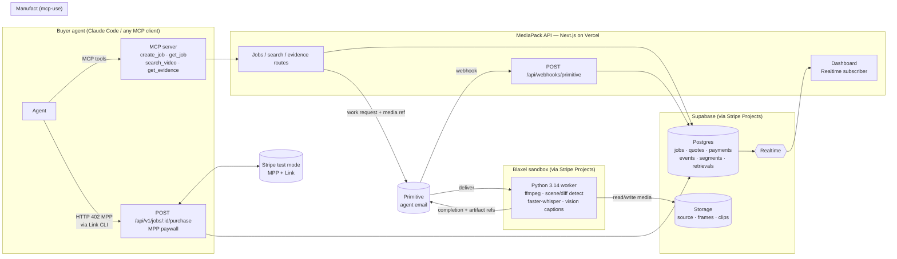
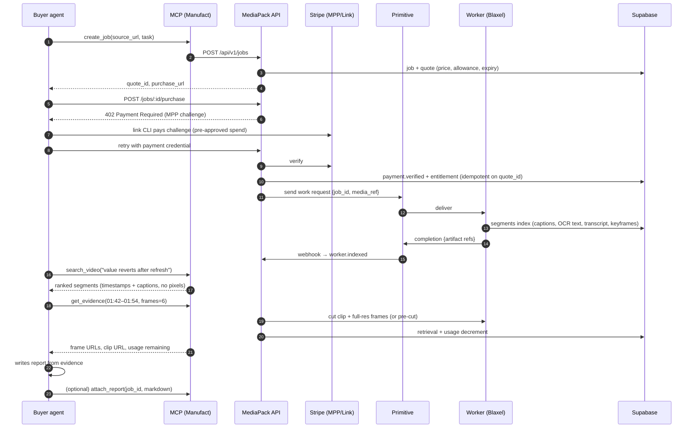

# MediaPack — Build Plan

> Initial product/design plan. The implemented Next.js + Blaxel + Manufact topology, current pack contract and Node worker are documented in [DECISIONS.md](DECISIONS.md), [CONTRACTS.md](CONTRACTS.md) and the [README](README.md). Historical Vercel, Python-worker and route examples below are superseded where those documents differ. Use the [release checklist](docs/RELEASE-CHECKLIST.md) for current deployment and verification steps.

> **Exa for video.** Agents pay once to index a video, then search it and retrieve
> timestamped frames and playable clips — within a purchased allowance.

Deadline: **Sun 10:00 submission** (GitHub + video). Tracks: **Primitive + Stripe** (primary), Manufact (MCP) secondary. Overall prize = YC interview.

Visual target: `apps/web` (`pnpm dev`). The dashboard is built on the real data layer
(`lib/types.ts` → `lib/reduce.ts#project`) and currently fed by a simulated replay
(`lib/demo/useDemoRun.ts`) of the exact event stream in §5. Going live = swap the replay
hook for a Supabase Realtime subscription on `events`; no component changes.

---

## 0. Product decisions (locked)

| Decision | Choice | Why |
|---|---|---|
| Positioning | General video search for agents | Bigger market, YC-shaped. "Coding-agent bug triage" is the hero demo, not the product. |
| Unit of sale | **One job = one video indexed + an allowance** ($0.50 test-mode) | Stripe SPT card minimum is $0.50; per-query micro-charges below that don't work on cards. Queries draw down the allowance. |
| Allowance | 2,000 text tokens · 8 frames · 15 s of clip | Enforced server-side. Shown in UI as meters. |
| Customer | The agent. Human UI = visibility + payment approval only (90/10 rule). | Matches kickoff thesis. |
| Demo proof | Two different videos → different timestamps/frames/answers | "Input determines output." |
| Honesty | UI labels test mode; root cause never claimed from video alone | Judges reward credibility. |

---

## 1. Architecture



### Critical-path sequence



**Why index-then-retrieve:** a 1-hour video is ~1M tokens if stuffed into context. MediaPack
indexes once (cheap model + local Whisper), then agents pay only for the pixels they pull.
The usage meters count *returned* media, not processed media.

---

## 2. Repo layout

```
mediapack/
  AGENTS.md
  PLAN.md
  apps/web/                      # Next.js (App Router): dashboard + REST API + MPP endpoint
    app/(dash)/jobs/[id]/page.tsx
    app/api/v1/jobs/route.ts               # POST create job+quote
    app/api/v1/jobs/[id]/route.ts          # GET job (status, index summary, usage)
    app/api/v1/jobs/[id]/purchase/route.ts # MPP 402 paywall
    app/api/v1/jobs/[id]/search/route.ts
    app/api/v1/jobs/[id]/evidence/route.ts
    app/api/webhooks/primitive/route.ts
    lib/{supabase,stripe-mpp,primitive,allowance,events}.ts
  apps/mcp/                      # mcp-use server, thin proxy over REST; deploy to Manufact
  worker/                        # Python 3.14, venv, ffmpeg; runs in Blaxel
    mediapack_worker/{ingest,detect,transcribe,caption,clip,primitive_io}.py
    tests/
  packages/shared/               # zod schemas: Job, Quote, Event, Segment, Evidence
  supabase/migrations/0001_init.sql
  fixtures/                      # settings-reset.mp4, kickoff-excerpt.mp4 (real recordings)
  scripts/demo-agent.md          # the exact fresh-agent prompt used in the video
```

---

## 3. Data model (`supabase/migrations/0001_init.sql`)

```sql
create table jobs (
  id text primary key,                  -- 'MP-1042' style, human-readable
  source_url text not null,
  source_name text, duration_ms int, task text,
  status text not null default 'quoted', -- quoted|paid|dispatched|indexing|indexed|delivered|failed
  created_by text,                       -- agent identity / MCP client name
  created_at timestamptz default now()
);
create table quotes (
  id text primary key, job_id text references jobs on delete cascade,
  amount_cents int not null, currency text default 'usd',
  allow_text_tokens int, allow_frames int, allow_clip_ms int,
  max_duration_ms int, expires_at timestamptz not null
);
create table payments (
  id text primary key,                   -- stripe payment/receipt id
  job_id text references jobs, quote_id text unique references quotes, -- unique = no double charge
  amount_cents int, status text, raw jsonb, created_at timestamptz default now()
);
create table events (
  id bigserial primary key, job_id text references jobs on delete cascade,
  type text not null, source text not null,  -- stripe|primitive|worker|agent|api
  data jsonb default '{}', created_at timestamptz default now()
);
create table segments (                  -- the searchable index
  id bigserial primary key, job_id text references jobs on delete cascade,
  start_ms int, end_ms int, keyframe_path text,
  caption text, ocr_text text, transcript text,
  tsv tsvector generated always as (to_tsvector('english',
      coalesce(caption,'')||' '||coalesce(ocr_text,'')||' '||coalesce(transcript,''))) stored
);
create index on segments using gin(tsv);
create table retrievals (
  id bigserial primary key, job_id text references jobs,
  kind text, start_ms int, end_ms int,
  frames_returned int default 0, clip_ms_returned int default 0, text_tokens_returned int default 0,
  artifact_paths text[], created_at timestamptz default now()
);
alter publication supabase_realtime add table events, jobs;
```

Allowance check = `sum(retrievals.*) + requested <= quote.allow_*`, done in a single
SQL function `consume_allowance(job_id, frames, clip_ms, tokens)` that raises on overage
(atomic, no race between parallel agent calls).

---

## 4. API & MCP contract

| MCP tool | REST | Returns |
|---|---|---|
| `create_job(source_url, task)` | `POST /api/v1/jobs` | `job_id, quote{amount, allowance, expires_at}, purchase_url, dashboard_url` |
| — (paid via Link CLI) | `POST /api/v1/jobs/:id/purchase` | `402` MPP challenge → `200 {receipt}` |
| `get_job(job_id)` | `GET /api/v1/jobs/:id` | status, events tail, index summary (segment count, coarse chapter list), usage |
| `search_video(job_id, query, k=8)` | `POST .../search` | `[{start_ms,end_ms,caption,ocr_text,transcript_snippet,score}]` — text only, counts toward text tokens |
| `get_evidence(job_id, start_ms, end_ms, frames)` | `POST .../evidence` | signed frame URLs, clip URL, `usage_remaining` |

Rules (AGX):
- Every error body has `{error, hint, next_action}` — e.g. `402` → "pay with `link` at purchase_url", `409 ALLOWANCE_EXCEEDED` → remaining amounts.
- `create_job` with same `(source_url, task, idempotency_key)` returns the existing job — retries never re-charge.
- Not paid yet → search/evidence return `402` with the purchase pointer, never a vague 403.
- Search: Postgres FTS rank → top 20 → cheap LLM rerank against query → top k. Add pgvector only if FTS misses on demo videos.

---

## 5. Event stream (drives UI; prototype uses identical names)

| type | source | data |
|---|---|---|
| `job.created` | api | source_name, duration_ms, task |
| `quote.issued` | api | amount_cents, allowance |
| `payment.challenge` | stripe | challenge_id |
| `payment.verified` | stripe | payment_id, amount_cents, mode:'test' |
| `primitive.dispatched` | primitive | message_id, to |
| `worker.started` | worker | sandbox_id |
| `worker.progress` | worker | stage: probe|detect|transcribe|caption, pct |
| `worker.indexed` | worker | segments, keyframes, ms_elapsed |
| `agent.search` | agent | query, hits:[{start_ms,end_ms,score}] |
| `agent.retrieved` | agent | start_ms, end_ms, frames, clip_ms |
| `primitive.delivered` | primitive | message_id, artifacts |
| `report.ready` | agent | title, steps[] |

UI renders **only** from these rows (Supabase Realtime on `events`). No client-side fake timers in the real app.

---

## 6. Worker pipeline (Python 3.14, `worker/`)

1. **probe** — `ffprobe` duration, fps, audio presence; reject > `max_duration_ms`.
2. **detect** — screen recordings change in small regions, so scene-cut alone misses "30→60".
   Use ffmpeg `select='gt(scene,0.02)'` **plus** a 1 fps sample, then dedupe by perceptual
   hash (`imagehash`). Target 20–60 keyframes for 3 min.
3. **transcribe** — `faster-whisper` (small, CPU) if audio exists. Free.
4. **caption** — batch keyframes (≤8 per call) to a cheap vision model (`claude-haiku-5-5`)
   with prompt: "For each frame: visible UI text verbatim (OCR), one-line description of
   state, what changed vs previous." Store `caption`, `ocr_text`.
5. **segments** — merge adjacent keyframes into segments `[start,end]`; upload thumbnails.
6. **clip on demand** — `ffmpeg -ss S -to E -c:v libx264 -preset veryfast -crf 26` → Storage,
   signed URL. Full-res frames extracted at exact requested timestamps.

Target latency for a 3-min recording: **index < 60 s**. Measure and put the number in the demo.
Cost target: < $0.10/job model spend. Log both per job in `events.data`.

---

## 7. Build order (≈18 h). Each milestone ends runnable.

| # | Hours | Milestone | Done when |
|---|---|---|---|
| 0 | 0–1 | **Verify-first spikes** (see §8). Record findings in `AGENTS.md`. | Each integration has one working hello-world call or a decided fallback. |
| 1 | 1–3 | Stripe Projects → Supabase (+ Blaxel). Migration applied. Next.js skeleton + `POST /jobs`, `GET /jobs/:id`. | `curl` creates a job, row visible. |
| 2 | 3–6 | Worker runs **locally** on `fixtures/settings-reset.mp4` → segments in DB. Tests on detect/segment logic. | `search` returns the 01:44–01:50 region for "timeout reset". |
| 3 | 6–8 | MPP purchase endpoint + Link CLI pay from terminal. Idempotent entitlement. | Stripe test dashboard shows payment tied to job id; retry doesn't double-charge. |
| 4 | 8–10 | Primitive dispatch → worker in Blaxel → completion webhook. | Same job shows `primitive.dispatched` and `primitive.delivered` with real message ids. |
| 5 | 10–12 | Evidence endpoint + allowance function + clip cutting. MCP server (mcp-use) on Manufact. | Fresh Claude Code session completes whole flow via MCP only. |
| 6 | 12–15 | Swap `useDemoRun` for Supabase Realtime in `apps/web` (UI already built). | Live run visible end-to-end with no mock data. |
| 7 | 15–16 | Second video (kickoff excerpt). AGX pass: 3 fresh agents "go use MediaPack", fix every confusion. | Both videos produce different correct timestamps. |
| 8 | 16–18 | Record demo video, README, `stripe projects share` URL, submit. | Submitted before 09:30. |

**Cut line if behind:** drop Blaxel (run worker on a Fly/local box, still via Primitive) before
dropping Primitive or Stripe — those are the tracks.

---

## 8. Verify-first checklist (hour 0 — do not trust memory or this doc)

- [ ] **Stripe MPP server**: find the official MPP server SDK/middleware for Node in Stripe docs; confirm 402 challenge format and verification call in test mode.
- [ ] **Link CLI**: install, confirm the command that pays an MPP challenge and whether an approval *policy* can be set (autonomous) vs per-spend approval (baseline). Record which works.
- [ ] **Primitive**: send API, inbound delivery (webhook vs poll), large-payload/artifact reference mechanism.
- [ ] **Blaxel**: sandbox image with ffmpeg + Python 3.14; how to trigger from an inbound Primitive message; credit plan active on the hackathon account.
- [ ] **mcp-use / Manufact**: scaffold, deploy, test in Claude Code. Confirm MCP-app UI widget support (embed evidence view).
- [ ] **Stripe Projects**: `stripe projects catalog` lists Supabase + Blaxel for this account.

---

## 9. Testing

- Unit (`worker/tests`): keyframe dedupe, segment merge, allowance math, idempotent purchase.
- Integration: `scripts/e2e.sh` — create job → pay (test) → wait indexed → search → evidence → assert clip URL returns `video/mp4` and frames exist at requested timestamps.
- AGX eval: fresh agent with only `scripts/demo-agent.md`; pass = report steps' timestamps fall inside the true interval of the fixture.

---

## 10. Demo script (2:00)

1. **0:00** Problem: "Agents can read code and docs. They can't watch video." Show 2:40 bug recording.
2. **0:15** Fresh Claude Code, one prompt (`scripts/demo-agent.md`). Dashboard on the right.
3. **0:30** Quote → Link pays → **Stripe test dashboard** shows the charge with job id.
4. **0:45** Primitive dispatch + delivery messages for the same job; worker indexes in N seconds.
5. **1:00** Agent's searches appear; it pulls 6 frames + 12 s clip. Usage meters move.
6. **1:20** Report: steps with timestamps, before/after frames, clip plays. Toggle **Agent view** — same data as JSON.
7. **1:35** Second video: the hackathon kickoff. "When are submissions due?" → clip at the exact moment.
8. **1:50** Numbers: index time, cost/job, tokens saved vs stuffing the video. Close: "Exa for video."
