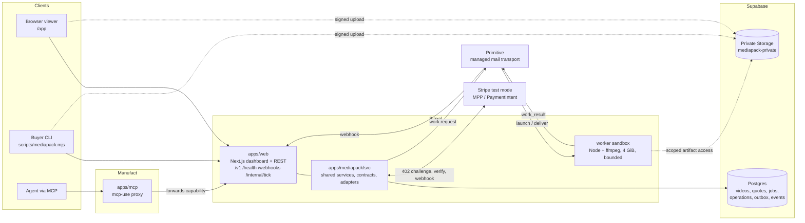
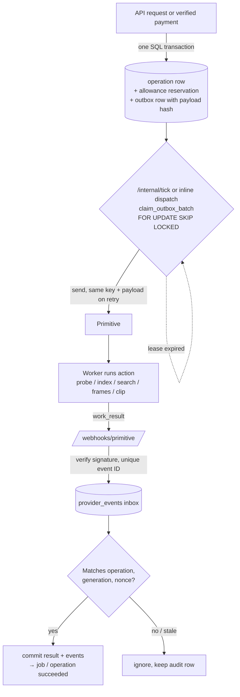
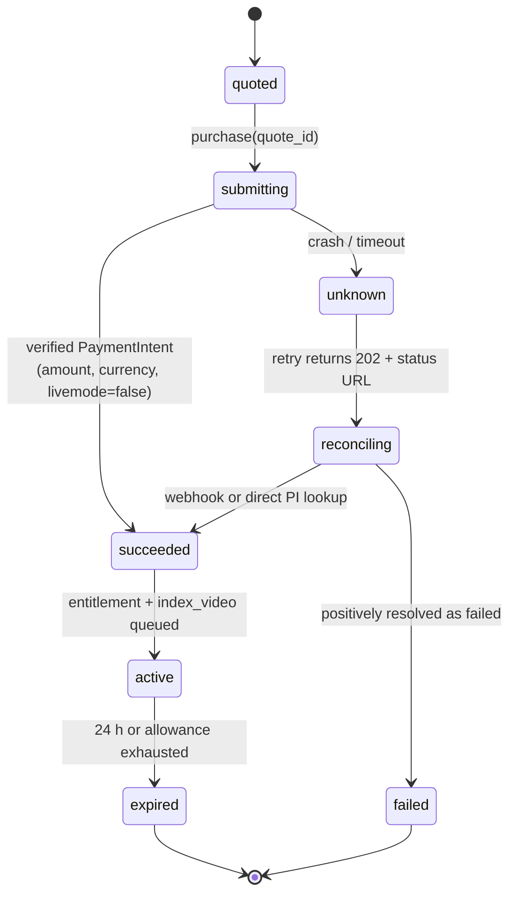
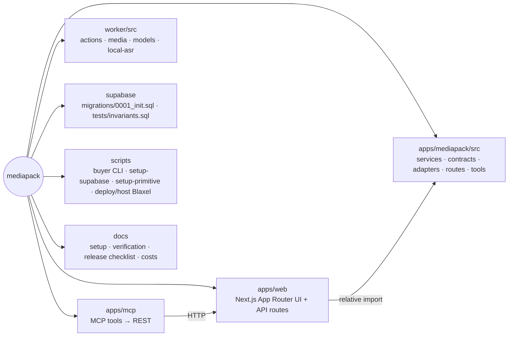

# MediaPack

Upload a video, buy a bounded Stripe sandbox pack, search visible actions or speech, and retrieve source frames and playable clips. The React viewer shows persisted jobs and activity; MCP and REST use the same service operations.

The application is **`apps/web`**: a Next.js dashboard and REST API hosted on **Blaxel**. **`apps/mcp`** is the deployed mcp-use proxy on **Manufact**, pointed at that same API. **`apps/mediapack/src`** holds the shared backend services, contracts and provider adapters. **`worker`** is the Node/TypeScript + ffmpeg worker launched in Blaxel sandboxes. The Next.js + Blaxel + Manufact topology supersedes older hosting choices in planning documents; `CONTRACTS.md` describes the product and wire behavior.

One USD 0.50 **test-mode** purchase covers one immutable video for 24 hours: three distinct searches, eight delivered frames, 15 seconds of clips, and 8,000 characters of evidence text. Input: MP4/WebM, at most 50 MiB and 180 seconds, up to 1920×1080 including portrait orientation. Server-side ffprobe validates the actual media before a quote is offered. Sampled indexing can miss brief events; the output describes observed evidence and cannot establish hidden causes.

Source: [ankitshah009/mediapack](https://github.com/ankitshah009/mediapack). Start with the [release checklist and documentation map](docs/RELEASE-CHECKLIST.md), [account setup](docs/SETUP-ACCOUNTS.md), and [dated verification record](docs/verification.md). The Next.js app, shared backend, Manufact proxy, worker and migrations belong in one complete source checkout.

Current runtime: [dashboard](https://mediapack-mediapack.preview.bl.run/app) · [Manufact MCP](https://fast-wave-awovc.run.mcp-use.com/mcp). The dashboard now has a **stable Blaxel preview URL** (`--stable-prefix mediapack`), so releases no longer change the origin used by Stripe, Primitive, the recovery schedule or the MCP proxy. The r9 host reports database OK and no missing provider settings. Supabase Free has the private 50 MiB bucket with strict database CA verification. Primitive delivery is enabled, with signed-event persistence and duplicate-event handling verified. The paid talk-recording and settings flows passed on r6, including the final Manufact MCP search and verified source frames/clips; the settings proof passed all 15 acceptance checks. R8/r9 change the dashboard only: the activity panel groups persisted events into one step per operation, clip thumbnails show their first frame, and provider launch errors are stored as readable text. See the [verification record](docs/verification.md).

## Efficiency and video memory

The source-linked timeline, index and exported evidence persist in Supabase, so another question can reuse inspected material after its disposable 4 GB worker exits. Primitive carries signed work-request/result messages with stable identities; SQL deduplication, leases and recovery make that transport reliable across process boundaries.

In the historical October 18 `gpt-4o-mini` talk run, before the longer temporal-search instructions were added, the 23-frame vision pass used 326,710 input tokens and the first search over 32 stored records used 2,507: **324,203 fewer input tokens** for that search: **99.23% lower incremental input**, about **130× smaller**, than repeating that same full pass. The first question still pays for indexing. Assuming the same search size for three questions gives 334,231 versus 980,130 input tokens, **645,899 avoided input tokens**, a **65.90% counterfactual reduction**, not a competing-product or NVIDIA benchmark. Output, provider caching and subsequently retrieved media are excluded. The three-search pack and 24-hour access window still apply; the historical 2,507-token search is not a fixed count for the final instructions.

In the project team's initial hands-on evaluation, Primitive was slightly more responsive than Inkbox; this is qualitative, with no controlled benchmark or Inkbox adapter in this repository. See [efficiency, memory and transport](docs/efficiency-and-memory.md) for the definitions, calculations, limits, Primitive's role, and NVIDIA VSS's existing vector/graph retrieval memory.

## How it works

### System topology

Every client calls the same service operations in `apps/mediapack/src`. Media bytes go straight to Storage and never pass through the API or MCP process. The worker never holds the Supabase service role or the merchant Stripe key.



### One purchase, end to end

```mermaid
sequenceDiagram
  autonumber
  participant U as Client (UI / CLI / MCP)
  participant API as apps/web + services
  participant DB as Postgres
  participant ST as Storage
  participant SP as Stripe (test)
  participant PR as Primitive
  participant WK as Worker

  U->>API: POST /v1/videos
  API->>DB: insert video (uploading)
  API-->>U: signed upload instructions
  U->>ST: upload MP4/WebM (≤ 50 MiB, ≤ 180 s)
  API->>WK: probe_video (ffprobe validates real media)
  API->>DB: create quote (USD 0.50, 24 h pack)
  U->>API: purchase(quote_id)
  API-->>U: 402 MPP challenge
  U->>SP: pay (mppx or Link)
  SP-->>API: verified PaymentIntent (sync and/or webhook)
  API->>DB: apply_verified_payment → job active + index_video op + outbox row
  API->>PR: send outbox message (stable Idempotency-Key)
  PR->>WK: work request
  WK->>ST: write frames / transcript / index artifacts
  WK->>PR: work_result (artifact IDs + hashes)
  PR->>API: POST /webhooks/primitive (signed)
  API->>DB: persist event, verify, commit result, append events
  U->>API: search / frames / clip → 202 + operation
  API->>DB: reserve_operation (consume_allowance in SQL)
  Note over U,API: Client polls GET /v1/jobs/:id; UI renders only persisted events
```

### Durable work pipeline

No network call happens inside a database transaction. Every side effect is written to `outbox` first and then sent by a leased dispatcher. Every inbound webhook is deduplicated by a unique key before it is acknowledged. That way a crash at any point can be resumed by `/internal/tick` and no work is lost or charged twice.



### Payment state gate

The gate runs before any code path that could charge. A repeat request while a payment is still uncertain never produces a second charge.



### Repository map



## Local setup

Use Node 22.22.2 or newer, npm, pnpm 12.11.2, ffmpeg/ffprobe, and Postgres 17 for database checks. Install package dependencies and prepare the server environment:

```sh
cd apps/mediapack
npm ci
cd ../web
pnpm install --frozen-lockfile
cp .env.example .env.local
cd ../../worker
npm ci
npm run build
cd ..
```

Fill `apps/web/.env.local` locally; hosted runtime values are held privately in `apps/web/.env.blaxel`. The Next.js server reads these values; do not prefix server secrets with `NEXT_PUBLIC_`. Generate three independent random values for `CAPABILITY_PEPPER`, `WORKER_TOKEN_SECRET`, and `INTERNAL_TICK_TOKEN`. Apply every `supabase/migrations/*.sql` in filename order to the target database. Create a **private** `mediapack-private` Storage bucket with a 50 MiB object limit; permit `video/mp4`, `video/webm`, `image/jpeg`, and `application/json`. Sources and derived artifacts share this bucket. Do not enable public reads or overwrite source objects.

Start the application from its package directory:

```sh
cd apps/web
pnpm build
pnpm dev
```

Open `http://localhost:3000/app/`. The Next.js service exposes `/v1`, `/health`, `/llms.txt`, `/webhooks/stripe`, `/webhooks/primitive`, and `/internal/tick`. Set `PUBLIC_BASE_URL` to the actual Blaxel HTTPS origin when deploying; Primitive must reach its webhook. Production start is `pnpm start` after the build. The separate Manufact MCP service exposes `/mcp` and uses `MEDIAPACK_API_URL` to reach the same API, forwarding the caller capability.

`GET /health` reports which credentials are configured. Presence is not a successful provider smoke test. Missing credentials produce actionable errors when their integration is used; configured health alone does not prove paid media processing works.

## Provider gates

| Integration | Required setup | What it enables |
| --- | --- | --- |
| Supabase Free | `DATABASE_URL`, `DATABASE_CA_CERT_BASE64`, `SUPABASE_URL`, server-only service role, migrations and private 50 MiB bucket | Verified database TLS, ownership, upload, durable operations and artifacts |
| Stripe merchant | Persistent sandbox key, owned webhook secret, `PAYMENTS_MODE=test`; current merchant explicitly uses `STRIPE_TEST_NETWORK_ID=internal` | Sandbox MPP challenges, verified PaymentIntent and recovery |
| Buyer | `MPPX_STRIPE_SECRET_KEY=sk_test_…` and explicit `MPPX_STRIPE_TEST_NETWORK_ID=internal` for this merchant | Authorized USD 0.50 sandbox purchase; public Link wallets require an actual Stripe profile |
| Primitive | Sending permission, control/worker managed addresses, org webhook and signature secret | Durable work request/result transport |
| Blaxel | Existing credits; runtime `BL_CLIENT_CREDENTIALS`, `BL_WORKSPACE`, `BLAXEL_WORKER_IMAGE` | Next.js sandbox hosting, bounded workers and short-lived model gateway authentication |
| Manufact | Logged-in hosting account and `MEDIAPACK_API_URL` pointing at Blaxel | Thin MCP proxy deployment |
| Models / speech | Current `gpt-4o-mini` gateway for observations/search; packaged whisper.cpp 1.9.5 multilingual `base` for local speech | Visual/text model calls through Blaxel; source-audio transcription inside the 4 GB worker |

Native `bl login` authorizes local provisioning. The deployed control server uses persistent `BL_CLIENT_CREDENTIALS` for OAuth and `BL_WORKSPACE=mediapack`; it mints a short-lived gateway token per index/search launch. The worker receives that token, never the persistent client credentials. The configured gateway is `https://run.blaxel.ai/mediapack/models/sandbox-openai/v1`. Persistent workspace API keys are rejected for gateway forwarding. A direct `OPENAI_API_KEY` remains an alternative model adapter configuration, not a requirement for this deployment. Reuse existing credits; infrastructure billing is independent of Stripe test payments.

Stripe setup is reproducible with `node scripts/setup-stripe.mjs --plan`, then `--apply`, using the private server env file. It manages only this application's owned test webhook. The owned endpoint has been created, and signed-event handling has passed its fixture check; this does not assert a real payment-webhook recovery run.

Register the Stripe webhook at `/webhooks/stripe` for `payment_intent.succeeded`; a local Stripe listener has a different signing secret from a deployed endpoint. Register the org Primitive webhook at `/webhooks/primitive` without removing unrelated endpoints. Requests and replies use the same verified route. See [account setup](docs/SETUP-ACCOUNTS.md) and [integration research](docs/integrations/) for provider context; those documents include investigation results, which should be distinguished from a successful end-to-end deployment.

Primitive account setup is available as `node scripts/setup-primitive.mjs --plan`, then `--apply`. It discovers the existing verified managed domain, saves its signing secret and control/worker addresses in the private server env file, and prepares one **disabled org-wide** webhook without paid per-domain routing. Local CLI OAuth can authorize this setup but is never copied into the deployed app; save a persistent `PRIMITIVE_API_KEY` in `apps/web/.env.blaxel` for runtime access. An existing dedicated worker key is preserved; otherwise the supplied app key is reused for worker replies. Endpoint ownership is retained privately under `.blaxel/primitive-setup.json`, so a later preview URL change can rotate only this application's endpoint. Restart the host after config changes. Initial delivery stays disabled until database and signature checks pass. In the current runtime, delivery is enabled, signed events persist, and duplicate delivery is deduplicated. Both paid source flows, including final source-specific MCP search and exported frame/clip verification, have passed through the actual Primitive request/result path.

## Buyer CLI

Run from the repository root. All commands support `--help`. JSON results go to stdout; progress and generated retry IDs go to stderr.

```sh
export MEDIAPACK_URL=https://mediapack-mediapack.preview.bl.run
node scripts/mediapack.mjs bootstrap --name demo-agent
node scripts/mediapack.mjs upload /absolute/path/recording.mp4 --wait
node scripts/mediapack.mjs quote VIDEO_UUID
```

Bootstrap saves the owner capability in `~/.config/mediapack/client.json` with mode `0600` and prints only the client ID. `--config FILE` selects another private state file. `MEDIAPACK_TOKEN` may supply an existing capability through the environment. Keep this state outside public repositories and recordings. Each service origin has a separate saved owner.

Use the `video_id` from upload and `job_id` from quote in subsequent commands. Upload streams bytes; `--wait` polls actual server state and stops on failure or after the configured deadline. A video can remain in `probing` if provider delivery or worker credentials are missing.

Only execute the following when the sandbox purchase is authorized:

```sh
# Export the buyer Stripe sandbox key securely in this terminal first.
export MPPX_STRIPE_TEST_NETWORK_ID=internal
node scripts/mediapack.mjs buy JOB_UUID
node scripts/mediapack.mjs status JOB_UUID --wait
node scripts/mediapack.mjs search JOB_UUID "Where does the presenter export the PDF?" --wait
node scripts/mediapack.mjs frames JOB_UUID 12000,14000 --wait
node scripts/mediapack.mjs clip JOB_UUID 12000 18000 --wait
node scripts/mediapack.mjs pack JOB_UUID --out pack.json
node scripts/mediapack.mjs artifact ARTIFACT_UUID --out evidence.mp4
```

The default buyer uses the installed `mppx` SDK and Stripe's test-helper shared-token endpoint with `pm_card_visa`. It requires a buyer test key, accepts only a USD 0.50 test quote, and validates amount, currency and the external quote ID. The current merchant's internal test network requires both server `STRIPE_TEST_NETWORK_ID=internal` and buyer `MPPX_STRIPE_TEST_NETWORK_ID=internal`; it does not pretend a public Stripe profile exists. The normal `profile_test_…` path is still supported. An isolated real 402 → sandbox token → verified receipt 200 round trip succeeded for 50 minor USD units. A definitive HTTP 400 `parameter_unknown` for optional seller details/metadata permits one reduced test-helper request. Timeouts and other failures never trigger this fallback. There is one payment credential attempt, kept in memory, and upload/search never purchases automatically.

The optional `--via link` path requires an installed, authenticated `link-cli`. The helper probes `link-cli mpp pay --help` before using its flags. It uses `--test` and can accept `--spend-request-id lsrq_…` for an already approved **sandbox** spend against the actual merchant/amount. Without that option, Link normally needs approval in its mobile app. A spend explanation is not a wallet approval policy. The helper saves any spend-request ID emitted by Link and proxies requests over a temporary loopback address so the reusable MediaPack capability never appears in subprocess arguments. Link output is suppressed because it may contain wallet credentials. Public Link wallet purchases require an actual merchant Stripe profile; the current explicit internal test network does not establish that path. Link remains a separate account/profile smoke test.

Buyer attempts are recorded before token creation. If an attempt has an uncertain outcome, the helper refuses a second attempt for that quote. Poll `status JOB_UUID` and use the persisted payment/webhook reconciliation path. A local `started` record requires operator investigation if the service never received a payment credential; only clear that record after proving no charge occurred. Do not create another job to bypass reconciliation.

Use `--request-id UUID` to retry an upload/search/frame/clip operation with the identical body. The helper prints its generated ID before submitting. `operation JOB_UUID OPERATION_UUID --wait` resumes polling; `events JOB_UUID` reads the actual event log. `search JOB_UUID -` reads a question from stdin. Output files are private and never overwritten; artifact downloads verify SHA-256 when provided by the server. Signed URLs and pairing codes remain sensitive.

To watch this CLI owner's work in the browser:

```sh
node scripts/mediapack.mjs pair
```

Open the printed `/app/pair` URL and paste the one-time code. The browser receives an HttpOnly session for the same client. Bootstrapping independently in the browser creates a different owner and will not expose the CLI's jobs. MCP clients use the same capability in `Authorization: Bearer …`; never put it in a public URL.

## Worker image and recovery

The root `Dockerfile` points to `apps/web/Dockerfile`. It builds Next.js with standalone output and includes the shared service dependencies; no provider secret is copied into the image. Build from the repository root:

```sh
docker build -t mediapack-web:local .
docker run --rm --env-file apps/web/.env.local -p 3000:3000 mediapack-web:local
```

`blaxel.toml` uses a Blaxel **sandbox with a public preview** on port 3000. The image contains the compiled standalone Next.js server and Blaxel's sandbox API; local Docker runs serve Next.js directly, while `MEDIAPACK_HOST_MODE=sandbox` starts the process API. The hosting script launches and supervises the same production server through that API. See the [official preview guide](https://docs.blaxel.ai/Sandboxes/Preview-url). Ownership tokens and webhook signatures protect private operations. Application Runtime is private preview and was rejected by the current workspace; sandbox previews avoid that entitlement gate.

The official CLI was installed with release checksum verification only in `/tmp/mediapack-blaxel-bin`, with setup, skills, shell PATH changes and completions disabled. The user has confirmed existing workspace credits; no new plan is required. This CLI builds remotely, so the full local Colima disk does not block a credited remote build. First run the local-only preflight:

```sh
node scripts/deploy-blaxel.mjs
```

It probes the installed flags and checks the exact source archives while suppressing raw resolved configuration. Root and worker `.blaxelignore` files exclude environment files, private tooling state, dependencies, build caches, documents and source media before cloud upload. `.dockerignore` alone does not govern the Blaxel source archive.

After authenticating the authorized `mediapack` workspace, build remotely, then use the immutable tag returned by the builder:

```sh
/tmp/mediapack-blaxel-bin/bl push --workspace mediapack --type sandbox --name mediapack-web --yes --timeout 20m
node scripts/host-blaxel.mjs --image sandbox/mediapack-web:<built-immutable-tag> --name <new-sandbox-name> --env-file apps/web/.env.blaxel \
  --idle-ttl 24h --stable-prefix mediapack --move-from <previous-sandbox-name>
```

Use native `bl login` credentials or securely supplied `BL_API_KEY`/`BL_WORKSPACE`. The hosting script reads server values privately from the selected env file, sets runtime `PUBLIC_BASE_URL` to the actual preview origin, and verifies the running Next.js process plus public `/health`. Its report under ignored `.blaxel/web-host.json` includes missing provider setting names without their values. An existing running process is reused; add `--restart` to apply edited environment values. For a new image use a new `--name` (for example `mediapack-web-r10`) so a working deployment is retained. With `--stable-prefix NAME`, `PUBLIC_BASE_URL` is `https://NAME-<workspace>.preview.bl.run`; the script starts the new process, checks its per-release preview, and only then moves the stable preview off the `--move-from` sandbox, so callbacks and the MCP proxy keep one origin across releases.

The current deployment is `mediapack-web-r9`, serving [the dashboard](https://mediapack-mediapack.preview.bl.run/app) from image `sandbox/mediapack-web:b3df59cc77af80222164d`. Its compiled launcher requests 4 GB workers using `sandbox/mediapack-worker:be53b19cc608a18554956`. Readiness, database OK, no missing provider settings, `keepAlive: false` and the 24-hour deletion policy were verified. To restart this same deployment after editing its private environment while retaining the judging window:

```sh
node scripts/host-blaxel.mjs --image sandbox/mediapack-web:b3df59cc77af80222164d --name mediapack-web-r9 --env-file apps/web/.env.blaxel --idle-ttl 24h --stable-prefix mediapack --restart
```

Cost protection: the web process uses `keepAlive: false`, allowing automatic standby when connections end. The hosting helper defaults to `ttl-idle: 1h`; the current judging deployment explicitly uses `--idle-ttl 24h`, with a read-back `ttl-idle: 24h` delete policy. The launch omits process `timeout` and `waitForPorts`; readiness is checked separately. Despite SDK/documentation comments describing startup-only timeouts without keep-alive, the current sandbox-api implementation kills a process when an explicit timeout expires. The hosting script enforces the deletion policy on reused sandboxes and restarts any old keep-alive process. See [Blaxel expiration semantics](https://docs.blaxel.ai/Sandboxes/Expiration): activity means resume/suspend transitions, so a continuously active session can also be deleted after the configured interval. Deletion removes the sandbox and preview; rerun the host script and update external callback/Manufact URLs if the origin changes. Standby has no active compute charge, but snapshot storage is billed until deletion and retained images have a separate storage charge. This is not an account spending cap. The bounded worker process still uses keep-alive to finish its work, with a maximum 10-minute execution and 30-minute sandbox lifetime. Sandbox hosting does not provide Application revisions or deployment rollbacks; the deployed idle-aware Supabase recovery schedule handles due persisted work without continually waking the host. See [cost estimates](docs/blaxel-costs.md) for the $500 credit budget.

The deployed Manufact endpoint is [MediaPack MCP](https://fast-wave-awovc.run.mcp-use.com/mcp). The endpoint URL is stable. The source-specific search and evidence proof below ran through r6. The final read-only `get_job`/`get_pack` readback against the CSS-only r7 host preserved the correct search and four frame/two clip hash references, with no new operations or usage changes. All nine MCP tools were available and viewer assets returned HTTP 200. The search referenced source records `f21`/`f24` spanning 40–48 seconds. The exported 40.000-second frame shows 60 and Saved; the 46.000-second frame shows 30. The 40–48-second H.264 clip is 1280×800, decoded fully with ffmpeg exit zero, and its SHA-256 matched the recorded artifact. Client-owned capabilities are forwarded per request; the proxy does not contain the server's Stripe, Supabase or worker secrets. Use the same CLI owner for the associated evidence requests.

Build the worker from its own context; `.dockerignore` excludes local dependencies, virtual environments and build output:

```sh
docker build -t mediapack-worker:local worker
docker run --rm mediapack-worker:local ffmpeg -version
docker run --rm mediapack-worker:local ffprobe -version
```

Build the reusable worker image remotely from the worker directory, then set `BLAXEL_WORKER_IMAGE` to the returned real image reference:

```sh
cd worker
/tmp/mediapack-blaxel-bin/bl push --workspace mediapack --type sandbox --yes --timeout 20m
cd ..
```

Run this from `worker/`: this CLI's `--directory worker` from the repository root archives the whole root and overlays its Dockerfile without relocating `package.json`. The worker image contains compiled code under `/app`, ffmpeg, the Blaxel sandbox API and pinned whisper.cpp **1.9.5** with the multilingual **base** model. `BL_SANDBOX_USER_ENABLED=true` scopes workloads to the unprivileged `node` user. Each operation requests **4096 MiB (4 GB)** and launches `node dist/run.js` with a scoped manifest and Primitive reply credential. Only index/search workers receive a newly minted short-lived model token; media-only work receives no model credentials. The persistent Blaxel service account, buyer wallet and Supabase service role remain outside the worker. The Next.js host uses 2048 MiB. Exit zero means a result was delivered; inspect its persisted status for processing success.

Transcription now runs locally with whisper.cpp, not the gateway's unsupported audio-transcription endpoint. The real 4 GB cloud smoke transcribed **7.618 seconds of source audio in 44.864 seconds**. That measurement is for the tested short recording, not a general indexing-latency promise; model weights and engine are packaged and checksum-pinned, with no silent external ASR fallback.

`worker/blaxel.toml` follows the [official custom-image guide](https://docs.blaxel.ai/Sandboxes/Templates). Local container builds remain unverified because Colima ran out of space; no Docker data was pruned. Use the remote build path above, then verify the app's public `/health`, worker `ffmpeg`/`ffprobe`, sandbox API boot, and one fixed worker process. Source/config dry-runs prove packaging, not a successful cloud rollout.

The service attempts immediate dispatch after commits. Durable recovery is now installed in Supabase. Review or reconcile its owned schedule with:

```sh
node scripts/setup-recovery.mjs --plan --env-file apps/web/.env.blaxel
node scripts/setup-recovery.mjs --apply --env-file apps/web/.env.blaxel
```

The helper installs one private Supabase Cron job, due-work predicates, a pg_net dispatch function, a replay-nonce table, and Vault secrets for the active origin and signing key. Each due request uses a timestamp, nonce and HMAC signature; the scheduled request does not store a reusable bearer token in pg_net headers. The database makes **zero HTTP requests while idle**. An actual missed-inline-dispatch recovery completed in **34.6 seconds**. The final r7 recovery proof passed all 12 checks: fresh signed requests returned 200, replayed or tampered requests returned 401, and 300-second nonce retention was verified. During **70.493 seconds** of idle observation spanning two cron runs, the database made **zero HTTP requests**. Rerun `--apply` after changing the host origin or signing token. For an intentional one-off local/operator tick, `node --env-file=apps/web/.env.local scripts/tick.mjs` remains available; it is not the durable scheduler.

## Verification

```sh
bash scripts/test-db.sh
cd worker
npm run typecheck
npm test
cd ../apps/web
pnpm exec tsc --noEmit
pnpm lint
pnpm test
pnpm build
cd ../mcp
npm ci
npm run typecheck
npm run build
cd ../..
node --check scripts/mediapack.mjs
node --check scripts/tick.mjs
node scripts/mediapack.mjs --help
```

See [verification status](docs/verification.md) for exercised paths and remaining account gates. The database script starts a disposable local Postgres and applies migrations/invariants. Worker tests exercise the production media path with local I/O edges; paid providers require separate credentialed verification. The paid talk-recording flow completed upload/preflight, sandbox purchase, Primitive work/result, indexing/search and evidence retrieval. The final source-specific MCP search and source evidence against r6 also passed all 15 acceptance checks. Settings evidence covers 40–48 seconds; the separate talk recording produced 22–31.44-second evidence, demonstrating source-dependent results. The final backend suite passed 65 tests and the worker suite passed 39, including actual local Whisper checks. A fresh database applying both `0001_init.sql` and `0002_worker_launch_events.sql` passed all 42 SQL invariants. R7 changes only narrow-screen status-URL wrapping. Its final read-only MCP check preserved the completed r6 results without changing operations or usage. Deployed browser checks passed at 375 and 1280 pixels for both Sandbox buyer and Link tabs, including keyboard access, current-origin commands and payment/memory disclosures; all 40 checked assets returned 200 with no browser errors. Owned Stripe and Primitive callbacks on r7 passed signature persistence and duplicate-event handling checks. The settings ledger contains one entitlement, payment attempt, PaymentIntent and index operation. Exact replays left the ledger unchanged and caused no second payment. Its delivered usage is three searches, four frames, 14 seconds of clips and 834 text characters, with zero outstanding reservations. All downloaded artifact hashes matched, and the final clip decoded completely. A subsequent normal frame launch automatically reaped the completed search worker from standby to terminated. Preserve redacted job/payment/operation/message/artifact references as the run manifest. Never describe a mock or an unexecuted provider call as a successful integration.
