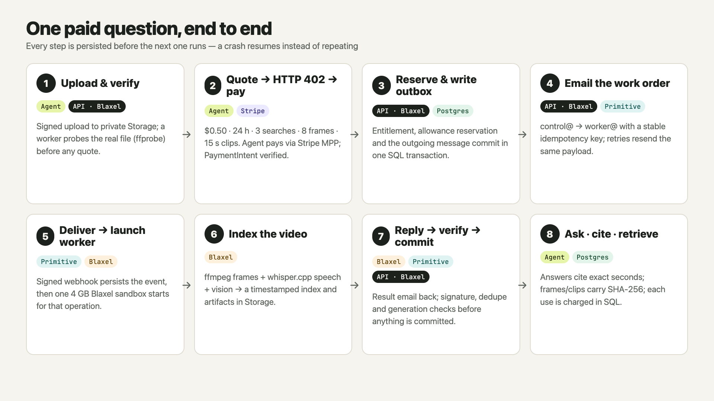
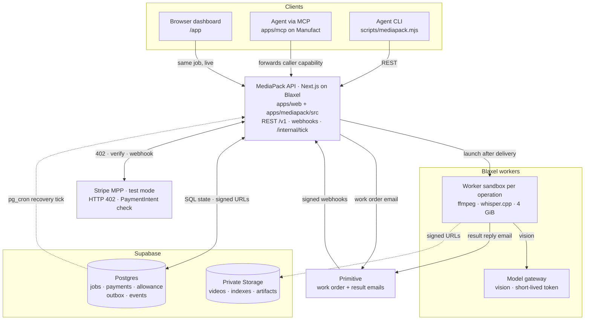
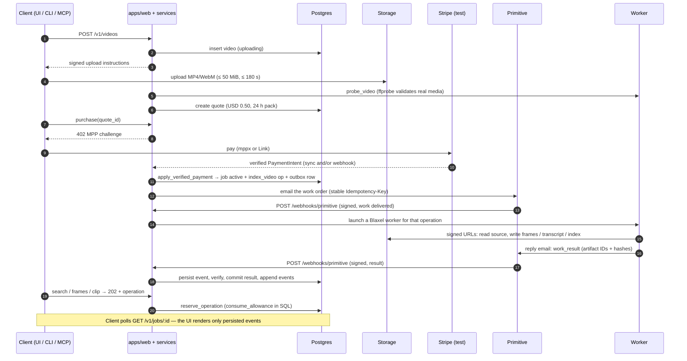
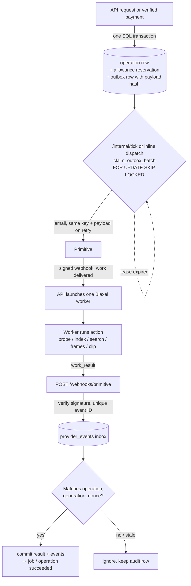
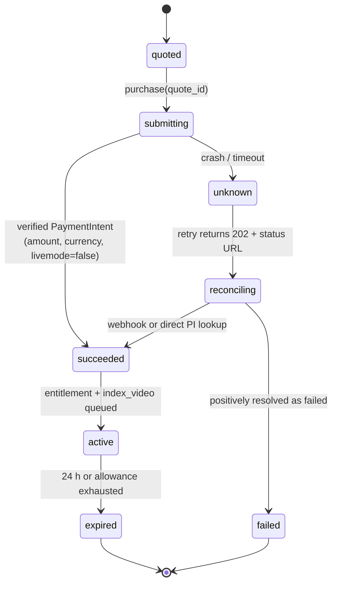
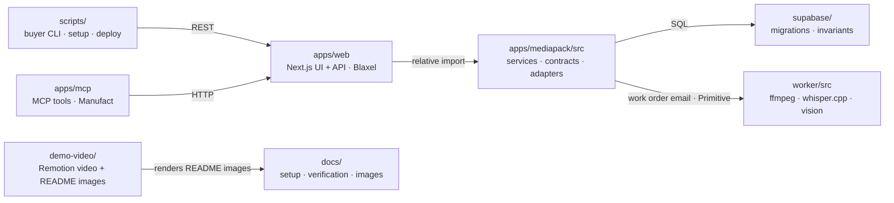

# MediaPack

Upload a video, buy a bounded Stripe sandbox pack, search visible actions or speech, and retrieve source frames and playable clips. The React viewer shows persisted jobs and activity; MCP and REST use the same service operations.

The application is **`apps/web`**: a Next.js dashboard and REST API hosted on **Blaxel**. **`apps/mcp`** is the deployed mcp-use proxy on **Manufact**, pointed at that same API. **`apps/mediapack/src`** holds the shared backend services, contracts and provider adapters. **`worker`** is the Node/TypeScript + ffmpeg worker launched in Blaxel sandboxes. The Next.js + Blaxel + Manufact topology supersedes older hosting choices in planning documents; `CONTRACTS.md` describes the product and wire behavior.

One USD 0.50 **test-mode** purchase covers one immutable video for 24 hours: three distinct searches, eight delivered frames, 15 seconds of clips, and 8,000 characters of evidence text. Input: MP4/WebM, at most 50 MiB and 180 seconds, up to 1920×1080 including portrait orientation. Server-side ffprobe validates the actual media before a quote is offered. Sampled indexing can miss brief events; the output describes observed evidence and cannot establish hidden causes.

Source: [ankitshah009/mediapack](https://github.com/ankitshah009/mediapack). Start with the [release checklist and documentation map](docs/RELEASE-CHECKLIST.md), [account setup](docs/SETUP-ACCOUNTS.md), and [dated verification record](docs/verification.md). The Next.js app, shared backend, Manufact proxy, worker and migrations belong in one complete source checkout.

Current runtime: [dashboard](https://mediapack-mediapack.preview.bl.run/app) · [Manufact MCP](https://fast-wave-awovc.run.mcp-use.com/mcp). The dashboard now has a **stable Blaxel preview URL** (`--stable-prefix mediapack`), so releases no longer change the origin used by Stripe, Primitive, the recovery schedule or the MCP proxy. The r11 host reports database OK and no missing provider settings, and a fresh-browser end-to-end check of the public URL passed 26/26 (see the verification record). Supabase Free has the private 50 MiB bucket with strict database CA verification. Primitive delivery is enabled, with signed-event persistence and duplicate-event handling verified. The paid talk-recording and settings flows passed on r6, including the final Manufact MCP search and verified source frames/clips; the settings proof passed all 15 acceptance checks. R8–r11 change the dashboard only: the activity panel groups persisted events into one step per operation, clip thumbnails show their first frame, provider launch errors are stored as readable text, a first upload starts a browser session automatically, and a citation clicked before the source loads still seeks it. See the [verification record](docs/verification.md).

## Efficiency and video memory

Index the video once, keep its timestamped visual and speech evidence, and reuse that memory for follow-up questions. Supabase stores the evidence; Primitive keeps requests and results connected across disposable Blaxel workers.

See [efficiency in numbers](#efficiency-in-numbers) for measured token inputs, the three-question projection, CPU transcription timings and idle-cost controls.

## How it works




Both images are rendered from React source in [`demo-video/src/Architecture.tsx`](demo-video/src/Architecture.tsx) and [`demo-video/src/JobFlow.tsx`](demo-video/src/JobFlow.tsx); regenerate them with `cd demo-video && npx remotion still src/index.ts ArchitectureImage ../docs/images/architecture.png` (and `JobFlowImage … job-flow.png`). Every work order and result is a real email in one Primitive thread per operation (subject `[mp:<operation>:g<generation>] <action>`), so the exchange stays retrievable through Primitive's email API after the job finishes, while Postgres keeps the authoritative job, payment and allowance state.

### System topology

Every client calls the same service operations in `apps/mediapack/src`. Media bytes go straight to Storage and never pass through the API or MCP process. The worker never holds the Supabase service role or the merchant Stripe key.



### One purchase, end to end



### Durable work pipeline

No network call happens inside a database transaction. Every side effect is written to `outbox` first and then sent by a leased dispatcher. Every inbound webhook is deduplicated by a unique key before it is acknowledged. That way a crash at any point can be resumed by `/internal/tick` and no work is lost or charged twice.



### Payment state gate

The gate runs before any code path that could charge. A repeat request while a payment is still uncertain never produces a second charge.



### Repository map



## Local setup

Use Node 22.22.2 or newer, npm, pnpm 12.11.2, ffmpeg/ffprobe, and Postgres 17 for database checks. Install package dependencies and prepare the server environment:

```sh
cd apps/mediapack
npm ci
cd ../web
pnpm install --frozen-lockfile
cp .env.example .env.local
cd ../../worker
npm ci
npm run build
cd ..
```

Fill `apps/web/.env.local` locally; hosted runtime values are held privately in `apps/web/.env.blaxel`. The Next.js server reads these values; do not prefix server secrets with `NEXT_PUBLIC_`. Generate three independent random values for `CAPABILITY_PEPPER`, `WORKER_TOKEN_SECRET`, and `INTERNAL_TICK_TOKEN`. Apply every `supabase/migrations/*.sql` in filename order to the target database. Create a **private** `mediapack-private` Storage bucket with a 50 MiB object limit; permit `video/mp4`, `video/webm`, `image/jpeg`, and `application/json`. Sources and derived artifacts share this bucket. Do not enable public reads or overwrite source objects.

Start the application from its package directory:

```sh
cd apps/web
pnpm build
pnpm dev
```

Open `http://localhost:3000/app/`. The Next.js service exposes `/v1`, `/health`, `/llms.txt`, `/webhooks/stripe`, `/webhooks/primitive`, and `/internal/tick`. Set `PUBLIC_BASE_URL` to the actual Blaxel HTTPS origin when deploying; Primitive must reach its webhook. Production start is `pnpm start` after the build. The separate Manufact MCP service exposes `/mcp` and uses `MEDIAPACK_API_URL` to reach the same API, forwarding the caller capability.

`GET /health` reports which credentials are configured. Presence is not a successful provider smoke test. Missing credentials produce actionable errors when their integration is used; configured health alone does not prove paid media processing works.

## Provider gates

| Integration | Required setup | What it enables |
| --- | --- | --- |
| Supabase Free | `DATABASE_URL`, `DATABASE_CA_CERT_BASE64`, `SUPABASE_URL`, server-only service role, migrations and private 50 MiB bucket | Verified database TLS, ownership, upload, durable operations and artifacts |
| Stripe merchant | Persistent sandbox key, owned webhook secret, `PAYMENTS_MODE=test`; current merchant explicitly uses `STRIPE_TEST_NETWORK_ID=internal` | Sandbox MPP challenges, verified PaymentIntent and recovery |
| Buyer | `MPPX_STRIPE_SECRET_KEY=sk_test_…` and explicit `MPPX_STRIPE_TEST_NETWORK_ID=internal` for this merchant | Authorized USD 0.50 sandbox purchase; public Link wallets require an actual Stripe profile |
| Primitive | Sending permission, control/worker managed addresses, org webhook and signature secret | Durable work request/result transport |
| Blaxel | Existing credits; runtime `BL_CLIENT_CREDENTIALS`, `BL_WORKSPACE`, `BLAXEL_WORKER_IMAGE` | Next.js sandbox hosting, bounded workers and short-lived model gateway authentication |
| Manufact | Logged-in hosting account and `MEDIAPACK_API_URL` pointing at Blaxel | Thin MCP proxy deployment |
| Models / speech | Current `gpt-4o-mini` gateway for observations/search; packaged whisper.cpp 1.9.5 multilingual `base` for local speech | Visual/text model calls through Blaxel; source-audio transcription inside the 4 GB worker |

Native `bl login` authorizes local provisioning. The deployed control server uses persistent `BL_CLIENT_CREDENTIALS` for OAuth and `BL_WORKSPACE=mediapack`; it mints a short-lived gateway token per index/search launch. The worker receives that token, never the persistent client credentials. The configured gateway is `https://run.blaxel.ai/mediapack/models/sandbox-openai/v1`. Persistent workspace API keys are rejected for gateway forwarding. A direct `OPENAI_API_KEY` remains an alternative model adapter configuration, not a requirement for this deployment. Reuse existing credits; infrastructure billing is independent of Stripe test payments.

Stripe setup is reproducible with `node scripts/setup-stripe.mjs --plan`, then `--apply`, using the private server env file. It manages only this application's owned test webhook. The owned endpoint has been created, and signed-event handling has passed its fixture check; this does not assert a real payment-webhook recovery run.

Register the Stripe webhook at `/webhooks/stripe` for `payment_intent.succeeded`; a local Stripe listener has a different signing secret from a deployed endpoint. Register the org Primitive webhook at `/webhooks/primitive` without removing unrelated endpoints. Requests and replies use the same verified route. See [account setup](docs/SETUP-ACCOUNTS.md) and [integration research](docs/integrations/) for provider context; those documents include investigation results, which should be distinguished from a successful end-to-end deployment.

Primitive account setup is available as `node scripts/setup-primitive.mjs --plan`, then `--apply`. It discovers the existing verified managed domain, saves its signing secret and control/worker addresses in the private server env file, and prepares one **disabled org-wide** webhook without paid per-domain routing. Local CLI OAuth can authorize this setup but is never copied into the deployed app; save a persistent `PRIMITIVE_API_KEY` in `apps/web/.env.blaxel` for runtime access. An existing dedicated worker key is preserved; otherwise the supplied app key is reused for worker replies. Endpoint ownership is retained privately under `.blaxel/primitive-setup.json`, so a later preview URL change can rotate only this application's endpoint. Restart the host after config changes. Initial delivery stays disabled until database and signature checks pass. In the current runtime, delivery is enabled, signed events persist, and duplicate delivery is deduplicated. Both paid source flows, including final source-specific MCP search and exported frame/clip verification, have passed through the actual Primitive request/result path.

## Buyer CLI

Run from the repository root. All commands support `--help`. JSON results go to stdout; progress and generated retry IDs go to stderr.

```sh
export MEDIAPACK_URL=https://mediapack-mediapack.preview.bl.run
node scripts/mediapack.mjs bootstrap --name demo-agent
node scripts/mediapack.mjs upload /absolute/path/recording.mp4 --wait
node scripts/mediapack.mjs quote VIDEO_UUID
```

Bootstrap saves the owner capability in `~/.config/mediapack/client.json` with mode `0600` and prints only the client ID. `--config FILE` selects another private state file. `MEDIAPACK_TOKEN` may supply an existing capability through the environment. Keep this state outside public repositories and recordings. Each service origin has a separate saved owner.

Use the `video_id` from upload and `job_id` from quote in subsequent commands. Upload streams bytes; `--wait` polls actual server state and stops on failure or after the configured deadline. A video can remain in `probing` if provider delivery or worker credentials are missing.

Only execute the following when the sandbox purchase is authorized:

```sh
# Export the buyer Stripe sandbox key securely in this terminal first.
export MPPX_STRIPE_TEST_NETWORK_ID=internal
node scripts/mediapack.mjs buy JOB_UUID
node scripts/mediapack.mjs status JOB_UUID --wait
node scripts/mediapack.mjs search JOB_UUID "Where does the presenter export the PDF?" --wait
node scripts/mediapack.mjs frames JOB_UUID 12000,14000 --wait
node scripts/mediapack.mjs clip JOB_UUID 12000 18000 --wait
node scripts/mediapack.mjs pack JOB_UUID --out pack.json
node scripts/mediapack.mjs artifact ARTIFACT_UUID --out evidence.mp4
```

The default buyer uses the installed `mppx` SDK and Stripe's test-helper shared-token endpoint with `pm_card_visa`. It requires a buyer test key, accepts only a USD 0.50 test quote, and validates amount, currency and the external quote ID. The current merchant's internal test network requires both server `STRIPE_TEST_NETWORK_ID=internal` and buyer `MPPX_STRIPE_TEST_NETWORK_ID=internal`; it does not pretend a public Stripe profile exists. The normal `profile_test_…` path is still supported. An isolated real 402 → sandbox token → verified receipt 200 round trip succeeded for 50 minor USD units. A definitive HTTP 400 `parameter_unknown` for optional seller details/metadata permits one reduced test-helper request. Timeouts and other failures never trigger this fallback. There is one payment credential attempt, kept in memory, and upload/search never purchases automatically.

The optional `--via link` path requires an installed, authenticated `link-cli`. The helper probes `link-cli mpp pay --help` before using its flags. It uses `--test` and can accept `--spend-request-id lsrq_…` for an already approved **sandbox** spend against the actual merchant/amount. Without that option, Link normally needs approval in its mobile app. A spend explanation is not a wallet approval policy. The helper saves any spend-request ID emitted by Link and proxies requests over a temporary loopback address so the reusable MediaPack capability never appears in subprocess arguments. Link output is suppressed because it may contain wallet credentials. Public Link wallet purchases require an actual merchant Stripe profile; the current explicit internal test network does not establish that path. Link remains a separate account/profile smoke test.

Buyer attempts are recorded before token creation. If an attempt has an uncertain outcome, the helper refuses a second attempt for that quote. Poll `status JOB_UUID` and use the persisted payment/webhook reconciliation path. A local `started` record requires operator investigation if the service never received a payment credential; only clear that record after proving no charge occurred. Do not create another job to bypass reconciliation.

Use `--request-id UUID` to retry an upload/search/frame/clip operation with the identical body. The helper prints its generated ID before submitting. `operation JOB_UUID OPERATION_UUID --wait` resumes polling; `events JOB_UUID` reads the actual event log. `search JOB_UUID -` reads a question from stdin. Output files are private and never overwritten; artifact downloads verify SHA-256 when provided by the server. Signed URLs and pairing codes remain sensitive.

To watch this CLI owner's work in the browser:

```sh
node scripts/mediapack.mjs pair
```

Open the printed `/app/pair` URL and paste the one-time code. The browser receives an HttpOnly session for the same client. Bootstrapping independently in the browser creates a different owner and will not expose the CLI's jobs. MCP clients use the same capability in `Authorization: Bearer …`; never put it in a public URL.

## Worker image and recovery

### Deploy Next.js on Blaxel

The root `Dockerfile` builds `apps/web` with standalone output and the shared backend. Provider secrets are supplied at runtime. For a local container:

```sh
docker build -t mediapack-web:local .
docker run --rm --env-file apps/web/.env.local -p 3000:3000 mediapack-web:local
```

The verified hosting path uses Blaxel's remote builder and a public sandbox preview on port 3000. The image includes Blaxel's sandbox API, which supervises the same compiled Next.js server. Application Runtime remains a separate private-preview feature; see the [preview guide](https://docs.blaxel.ai/Sandboxes/Preview-url).

First check packaging locally, then build and deploy from the repository root:

```sh
node scripts/deploy-blaxel.mjs
/tmp/mediapack-blaxel-bin/bl push --workspace mediapack --type sandbox --name mediapack-web --yes --timeout 20m
node scripts/host-blaxel.mjs --image sandbox/mediapack-web:<built-immutable-tag> --name <new-sandbox-name> --env-file apps/web/.env.blaxel \
  --idle-ttl 24h --stable-prefix mediapack --move-from <previous-sandbox-name>
```

Use native `bl login` or securely supplied Blaxel credentials. The preflight probes installed CLI flags and checks that archives exclude secrets, private tooling state, dependencies, caches and source media. The remote build avoids the local Colima disk limit recorded in [verification](docs/verification.md).

The hosting helper reads the private env file, sets `PUBLIC_BASE_URL`, and verifies Next.js readiness and database health. Use a new sandbox name for each image. With `--stable-prefix mediapack`, it checks the new release before moving the stable preview, preserving one origin for Stripe, Primitive, recovery and Manufact.

| Current deployment | Configuration |
| --- | --- |
| Dashboard | [mediapack-mediapack.preview.bl.run/app](https://mediapack-mediapack.preview.bl.run/app) |
| Web sandbox | `mediapack-web-r11` · 2048 MiB |
| Web image | `sandbox/mediapack-web:b30eaad65e240fa7494ff` |
| Worker image | `sandbox/mediapack-worker:be53b19cc608a18554956` · 4096 MiB |
| MCP endpoint | [Manufact MCP](https://fast-wave-awovc.run.mcp-use.com/mcp) |
| Judging lifecycle | Standby enabled · 24-hour idle-delete policy |

To apply edited private settings to the current web deployment:

```sh
node scripts/host-blaxel.mjs --image sandbox/mediapack-web:b30eaad65e240fa7494ff --name mediapack-web-r11 --env-file apps/web/.env.blaxel --idle-ttl 24h --stable-prefix mediapack --restart
```

The MCP proxy forwards each caller's capability to the API. Keep only `MEDIAPACK_API_URL` in its environment; provider, database and worker secrets stay on the control server. See [account setup](docs/SETUP-ACCOUNTS.md) for callback configuration and [hosting details](docs/blaxel-costs.md) for lifecycle semantics.

### Build the media worker

Local image checks:

```sh
docker build -t mediapack-worker:local worker
docker run --rm mediapack-worker:local ffmpeg -version
docker run --rm mediapack-worker:local ffprobe -version
```

Build remotely from the worker directory, then set `BLAXEL_WORKER_IMAGE` to the returned immutable image reference:

```sh
cd worker
/tmp/mediapack-blaxel-bin/bl push --workspace mediapack --type sandbox --yes --timeout 20m
cd ..
```

Run the push from `worker/`; this CLI's `--directory worker` from the repository root does not relocate the build context correctly. The image packages compiled Node/TypeScript, ffmpeg/ffprobe, the sandbox API, and checksum-pinned whisper.cpp **1.9.5** with multilingual **base** weights. No model download is required on the first job.

Each operation runs as the unprivileged `node` user in a **4 GB** sandbox. Index/search workers receive a newly minted short-lived gateway token; media-only workers receive no model credential. The persistent Blaxel service account, buyer wallet and Supabase service role remain on control. Exit zero confirms result delivery; the persisted result records processing success or failure. See the [worker README](worker/README.md) for runtime and transcription details.

### Recover interrupted work

Immediate dispatch follows each committed operation. Supabase Cron also checks persisted work and invokes recovery only when something is due:

```sh
node scripts/setup-recovery.mjs --plan --env-file apps/web/.env.blaxel
node scripts/setup-recovery.mjs --apply --env-file apps/web/.env.blaxel
```

The helper owns the due-work predicate, pg_net dispatch, replay-nonce table and Vault secrets. Scheduled calls use a timestamp, nonce and HMAC signature; reusable bearer credentials stay out of queued HTTP headers. Rerun `--apply` after changing the origin or signing key. A one-off operator tick remains available through `scripts/tick.mjs`.

Observed recovery and idle results are highlighted [below](#compute-and-idle-cost-controls); the full setup and failure behavior are in the [recovery runbook](docs/recovery-scheduler.md).

## Verification

| Recorded check | Result |
| --- | --- |
| Fresh public-browser session, r11 | **26/26 passed**: upload/session creation, validation, pairing, citations, evidence, receipt, mobile and authorization checks |
| Fresh paid CLI run, r11 | One $0.50 test purchase; correct 60 → 30 settings answer; unrelated deletion query returned no evidence and no citations |
| Two different source videos | Settings evidence at **40–48 s**; talk deadline evidence at **22–31.44 s** |
| Settings acceptance, r6 | **15/15 passed**; cited frames and eight-second clip matched SHA-256; full clip decoding passed |
| Payment and operation retries | Same PaymentIntent and entitlement; unchanged allowance; no duplicate index |
| SQL invariants | **42 passed** on a fresh database with both migrations |
| Worker tests | **39 passed**, including actual CPU Whisper, ffmpeg and transport |
| Manufact MCP | Nine tools; caller-owned access; persisted results and view assets verified |

These are dated results from different release checks. The [verification record](docs/verification.md) retains their exact versions, test boundaries and failed attempts. Stripe payments remain in **test mode**; public Link wallets require a genuine merchant profile.

<details>
<summary>Run the local checks</summary>

Run these from the repository root with the required local dependencies installed:

```sh
bash scripts/test-db.sh
cd worker
npm run typecheck
npm test
cd ../apps/web
pnpm exec tsc --noEmit
pnpm lint
pnpm test
pnpm build
cd ../mcp
npm ci
npm run typecheck
npm run build
cd ../..
node --check scripts/mediapack.mjs
node --check scripts/tick.mjs
node scripts/mediapack.mjs --help
```

The database script uses disposable local PostgreSQL. Worker tests exercise real media processing, with mocks at external I/O boundaries. Credentialed provider runs are recorded separately.

</details>

## Efficiency in numbers

**Index once. Search the saved timeline. Retrieve the source evidence you need.**

Follow-up questions reuse timestamped frame observations, visible text and speech instead of sending the full sampled video through vision again. Frames and clips are exported on demand, within the purchased allowance.

### Measured token inputs

One October 18, 2026 `gpt-4o-mini` talk run inspected **23 frames** and stored **32 visual/speech records**:

| Stage | Reported input tokens |
| --- | ---: |
| Initial visual indexing | 326,710 |
| One search over the stored index | 2,507 |
| Difference versus repeating that same full indexing pass | **324,203 fewer · 99.23% lower** |

**That search used about 130× less input than the recorded full visual pass.** The first question still pays the indexing cost: indexing plus its first search totals **329,217 input tokens**.

This historical search preceded the longer temporal-grounding instructions. Its 2,507-token count is a measured example, not a fixed cost for current searches.

### What reuse could save across three questions

Assuming each search used the same 2,507 input tokens as that measured search:

| Strategy | Total input tokens |
| --- | ---: |
| Repeat the same full visual pass for each question | 980,130 |
| Index once, then search three times | 334,231 |
| Projected reduction | **645,899 tokens · 65.90%** |

This is a **projection**, not three measured searches or a competing-product benchmark. Both comparisons exclude output tokens, provider caching and media subsequently consumed by the buyer agent. Actual counts depend on the video, question and model. See the [complete calculation and assumptions](docs/efficiency-and-memory.md).

### Video memory survives the worker

| Component | What it preserves or does |
| --- | --- |
| **Supabase** | The source identity, timestamped index, private evidence, ownership, payments and allowance ledger |
| **Primitive** | A retrievable email thread for each operation: work request, result reply, stable message identities and artifact references |
| **Control + SQL** | Committed outbox/inbox, deduplication, leases, generation checks and result application |
| **Blaxel worker** | Bounded media processing and model calls; committed evidence remains available after the worker exits |

**Primitive keeps the work conversation connected across disposable workers.** A repeated delivery, interrupted process or late reply can be reconciled against the same persisted operation and source. Media bytes move directly through private Storage; messages carry compact envelopes and references. That separation lets agents reuse both the saved evidence and the history of how it was produced.

The current pack includes three distinct searches, eight frames, 15 seconds of clips and 8,000 evidence characters for 24 hours. Memory reuse follows that access window and retention policy.

### Compute and idle-cost controls

| Efficiency fact | Recorded evidence or control |
| --- | --- |
| **Local speech transcription** | The 4 GB cloud smoke processed **44.864 s of audio in 7.618 s** with CPU Whisper and no audio API |
| **Paid indexing execution** | Talk: **15.208 s**; settings: **21.932 s**, excluding startup and time outside the measured worker interval |
| **Idle recovery** | **Zero HTTP requests** during a **70.493 s** observation spanning two successful cron runs |
| **Interrupted dispatch** | A committed operation recovered through the existing schedule in **34.585 s** |
| **Web standby** | `keepAlive: false` allows automatic standby; no active compute charge while suspended |
| **Bounded workers** | Completed owned workers are reclaimed before later launches; a **30-minute sandbox lifetime** bounds retention |
| **Judging host expiry** | Verified **24-hour idle-delete policy**; the helper defaults to one hour |

These timings describe individual recorded runs, not a general latency guarantee. Standby and cleanup reduce active compute and retained resources; images and snapshots still have storage charges. Blaxel's idle TTL follows resume/suspend events and can expire an active sandbox, so it is not a conventional last-request timer or a spending cap. See [dated rates, the $500 budget scenarios and expiration details](docs/blaxel-costs.md).

### Primitive, Inkbox and NVIDIA VSS

In the team's initial hands-on evaluation, **Primitive was slightly more responsive than Inkbox**, which informed the current choice. This is qualitative: no controlled latency benchmark is recorded, and the repository currently implements the Primitive adapter.

**NVIDIA VSS also provides persisted retrieval memory**, including vector/graph retrieval. MediaPack's focus is a bounded, paid agent workflow with source identity, reusable evidence, ownership and retry-safe operations. The token figures above do not establish NVIDIA performance or GPU superiority. See the [comparison and evaluation limits](docs/efficiency-and-memory.md#how-this-differs-from-nvidia-vss).
